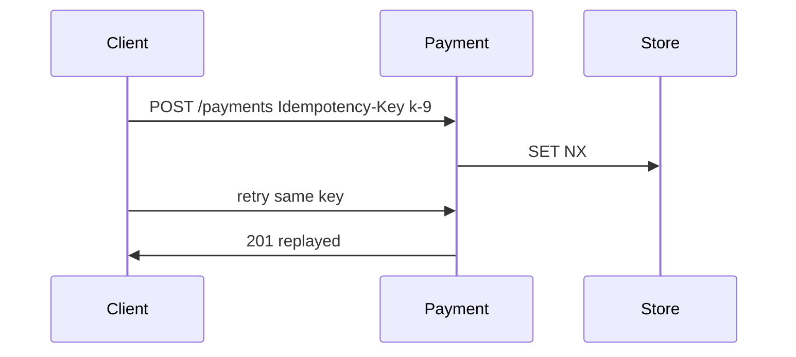

# 27. Idempotency-Key

**Category:** Resilience and consistency  |  **Status:** Working example included

Store key+response, replay on duplicates, 422 on body mismatch.

## Sequence


## Run
```bash
docker compose up -d
mvn spring-boot:run
```

## Part of
[system-design-concepts-master](../../README.md) - see the master repo for the full concept map.
